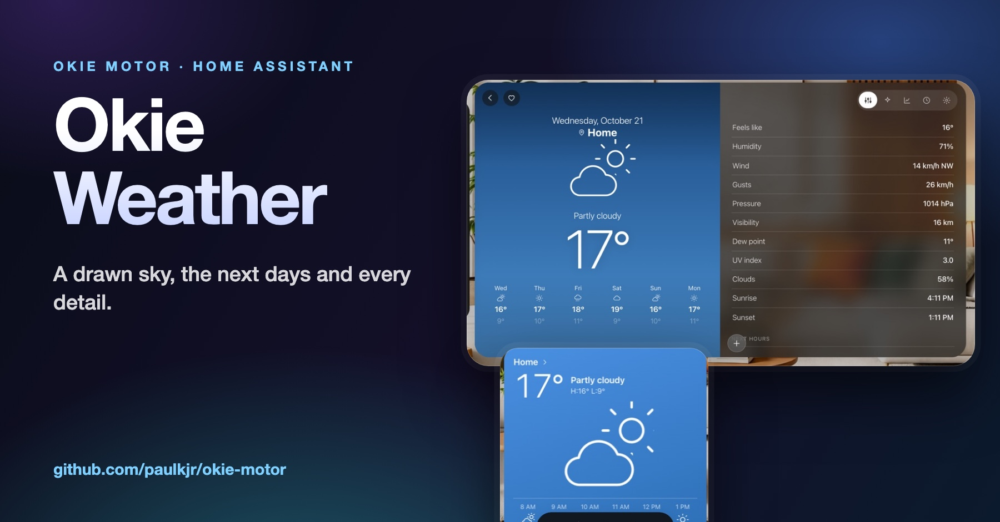
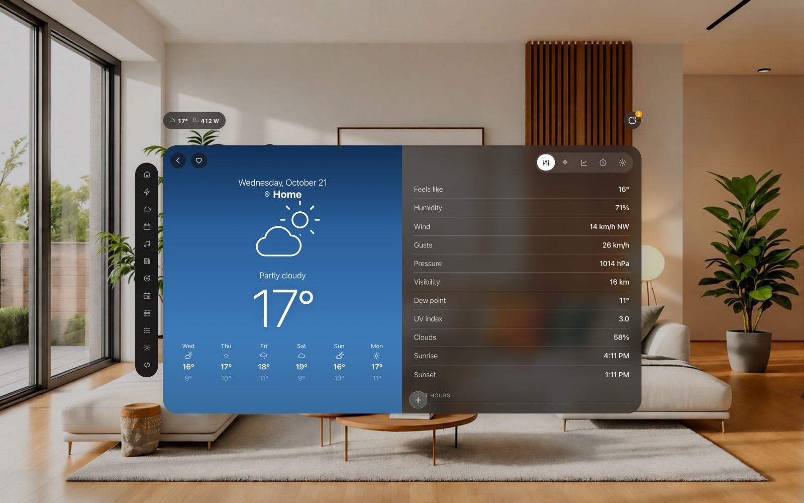
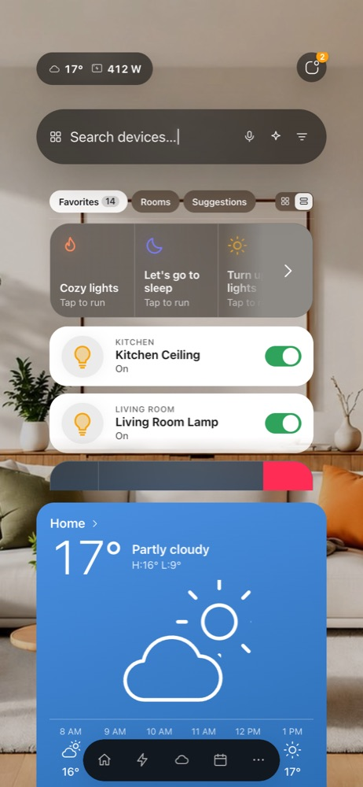

# Okie Weather

**A weather screen for Home Assistant in two pages: a drawn sky with the next days, and every detail with the next hours.**

> This repository is the project page. The code lives in **[Okie Motor](https://github.com/paulkjr/okie-motor)** (a dashboard card for Home Assistant, and a native iPhone and iPad app), where this part is one of the screens. The links below go to the exact files.

## What it does

* **Page 1:** the day and the place, a drawn sky (sun, moon, clouds, rain, and stars at night), the condition, the big temperature and the next days with their high and low
* **Page 2:** the details (feels like, humidity, wind, gusts, pressure, visibility, dew point, UV, clouds, sunrise and sunset, the moon) and the next hours
* On a phone one page at a time (swipe sideways, two dots show where you are); on a wide screen both pages side by side
* Extra places through [Open-Meteo](https://open-meteo.com) (free, weather data CC BY 4.0), next to the weather entity of your Home Assistant
* A weather widget in the iPhone and iPad app

## Screens

  
*Both pages side by side on a wide screen*

  
*The weather card on a phone*

## How it works

* **One set of icons everywhere.** The sky picture uses the same cloud, sun, moon and rain icons as the rest of the card; partly cloudy is a cloud with the sun or the moon peeking out from behind it.
* **Night is decided carefully:** the sun entity first, else the condition, else the hour. The stars are the same every time and stay in the upper part of the sky.
* **It only lists what the weather gives:** a detail row without a value is not drawn. The next hours start with Now, skip hours that are gone and stop at the limit.
* **Tested.** The sky, the night rule, the stars, the rows, the hours, the days and the place names are pure code with unit tests.

## Where the code is

| What | File |
|---|---|
| The weather screen | [`src/okie-weather.js`](https://github.com/paulkjr/okie-motor/blob/v0.52.5/src/okie-weather.js) |
| Tests | [`tests/weather.test.js`](https://github.com/paulkjr/okie-motor/blob/v0.52.5/tests/weather.test.js) |
| Tests of the widget page | [`tests/weather-widget.test.js`](https://github.com/paulkjr/okie-motor/blob/v0.52.5/tests/weather-widget.test.js) |
| iPhone / iPad: the weather screen | [`ios-app/App/WeatherScreen.swift`](https://github.com/paulkjr/okie-motor/blob/v0.52.5/ios-app/App/WeatherScreen.swift) |
| iPhone / iPad: the data | [`ios-app/App/WeatherModel.swift`](https://github.com/paulkjr/okie-motor/blob/v0.52.5/ios-app/App/WeatherModel.swift) |
| iPhone / iPad: the sky icons | [`ios-app/Shared/WeatherGlyph.swift`](https://github.com/paulkjr/okie-motor/blob/v0.52.5/ios-app/Shared/WeatherGlyph.swift) |

## Try it

* **Without installing anything:** download [`okie-demo.html`](https://github.com/paulkjr/okie-motor/releases/latest/download/okie-demo.html) and double-click it. It runs the whole card against a pretend Home Assistant.
* **In your Home Assistant:** add [paulkjr/okie-motor](https://github.com/paulkjr/okie-motor) as a custom repository in HACS (category Dashboard), or follow the [guides](https://github.com/paulkjr/okie-motor/tree/v0.52.5/docs/guides).

## Credits

* Original Fast Search concept and base implementation: [fastender](https://github.com/fastender) ([Fast Search Card](https://github.com/fastender/Fast-Search-Card))
* Hemma customization and ongoing tweaks: [willsanderson](https://github.com/willsanderson) ([Hemma](https://github.com/willsanderson/Hemma))

Okie Motor is an independent project, not made or endorsed by them. Built by directing Claude Code (an AI coding assistant): I design the screens and decide what ships, and every change is tested.

## Support

Enjoying this? Buy me a coffee, I wanna be a full time DJ/designer: https://ko-fi.com/paulkmusic

## Licence

GPL-3.0-or-later, like the rest of Okie Motor (see [LICENSE](LICENSE)).
